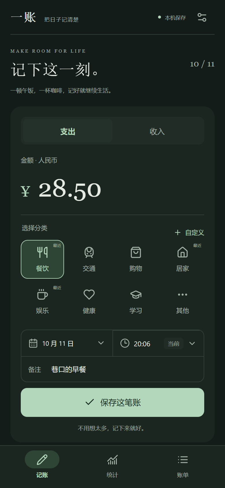
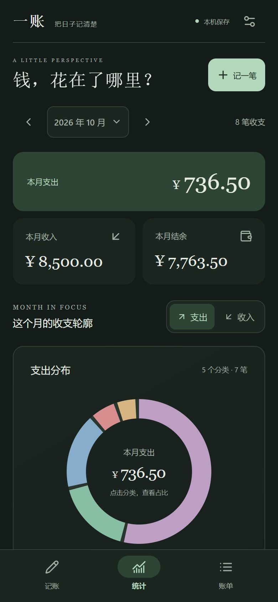
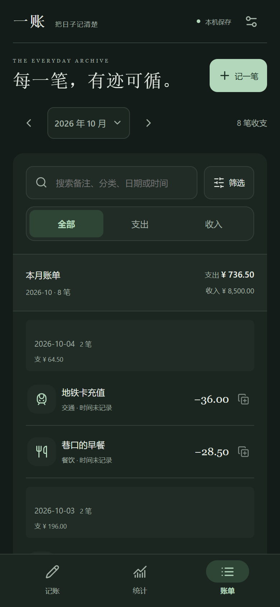

# 一账 · 把日子记清楚

一个本地优先的个人记账 App。记下每天的收支，用清楚的账单和图表了解钱花在哪里。

**[下载最新 Android APK](https://github.com/junnhwan/wanjune-ledger/releases/latest)** · Android 7.0 及以上 · 无需账号 · 离线记账

## 主要功能

- 快速录入收入与支出，自定义分类、日期、时分和备注。
- 账单搜索与筛选、编辑、删除撤销，以及「再记一笔」。
- 月度收支、分类环形图、每日柱状图、同期对比与累计趋势。
- 可选月度总预算和分类预算，查看剩余额度与超支。
- 暗色、浅色和跟随系统；自定义日期与月份面板。
- 本机保存、JSON 备份与恢复、备份提醒和应用内更新。

## 界面预览

截图来自当前版本的 Web 界面，使用演示账目，展示记账、统计和账单；Android 沿用同一套界面。

<table>
  <tr><th>记一笔</th><th>收支统计</th><th>账单明细</th></tr>
  <tr>
    <td></td>
    <td></td>
    <td></td>
  </tr>
</table>

## 安装与更新

从上方下载入口选择正式 `.apk`，按 Android 系统提示安装。已安装用户也可在设置中检查更新、下载并交给系统安装。

后续正式版直接覆盖安装，**不要先卸载**。升级前建议导出一份 JSON 备份；卸载或清除应用数据会删除本机账本。包名固定为 `cn.yizhang.ledger`。

## 数据与备份

账本保存在本机，无需电脑或服务器在线；目前没有账号或跨设备云同步。JSON 备份是未加密的个人收支文件，请保存到受保护的应用外位置。恢复会替换当前账本，恢复前先另存备份。

不同手机的系统行为存在差异，正式使用前请确认保存、重启、备份恢复和覆盖升级正常。此公开仓库用于分发 APK、更新信息、介绍与截图，源码保存在私有仓库。
