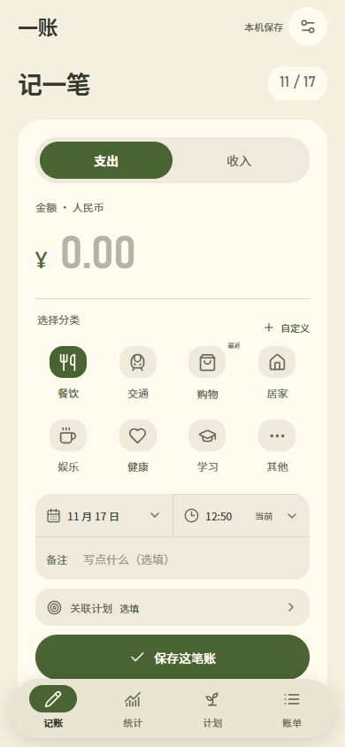
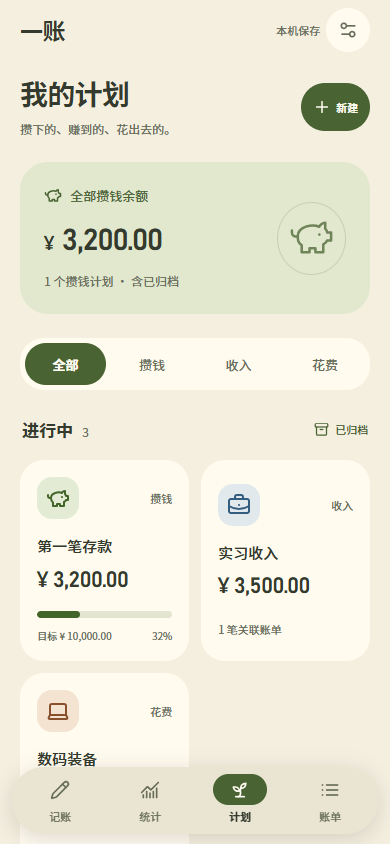

# 一账 · 把日子记清楚

一个本地优先的个人记账 App。随手记收支，为存款、收入和专项花费建立计划，用图表看清日常。

**[下载最新 Android APK](https://github.com/junnhwan/wanjune-ledger/releases/latest)** · Android 7.0 及以上 · 无需账号 · 离线记账

[一账 1.1.1（11）](https://github.com/junnhwan/wanjune-ledger/releases/tag/v1.1.1-11) 已发布。手机记账的保存按钮固定在导航或键盘上方，金额聚焦时用底线与光标提示。

## 主要功能

- 快速录入收入与支出，自定义分类、日期、时分和备注。
- 账单搜索与筛选、编辑、删除撤销，以及「再记一笔」。
- 按月、自定义起止日期或全部记录查看收支；支持跨月、跨年，以及近 7 天、近 30 天和今年快捷范围。
- 分类环形图、随时间跨度汇总的趋势图、可展开的金额/累计明细，以及对应范围账单；自定义时间与前一段等长时间比较。
- 可选月度总预算和分类预算，查看剩余额度与超支。
- 攒钱目标单独记录存入／取出；收入累计与专项花费关联账单，一笔可属于多个计划，总账不重复计算。
- 自定义名称、图标、颜色、目标／花费上限与备注，提供模板，支持归档和恢复。
- 暗色、暖纸浅色与跟随系统；连贯导航、弹层和进度动效，支持减少动态效果。
- 统计和计划一键生成分享图，预览后保存相册或系统分享，默认隐藏明细与备注。
- 本机保存、JSON 备份与恢复、备份提醒和应用内更新；更新支持加速线路、自动回退、下载速度与校验状态。

## 界面预览

以下为使用示例资料的 Web 手机布局截图，不是真机照片。

<table>
  <tr><th>暖纸记账</th><th>攒钱与专项</th><th>收支统计</th></tr>
  <tr>
    <td></td>
    <td></td>
    <td></td>
  </tr>
</table>

## 安装与更新

从上方下载入口选择正式 `.apk`，按 Android 系统提示安装。已安装用户也可在设置中检查更新、下载并交给系统安装。

可使用[加速下载 1.1.1 APK](https://gh-proxy.org/https://github.com/junnhwan/wanjune-ledger/releases/download/v1.1.1-11/yizhang-1.1.1-11-release.apk)，也可从上方官方发布页下载。

查看任意时间段：进入「统计 → 自定义」，分别选择开始和结束日期，例如 10 月 4 日至 11 月 4 日（包含两端，共 32 天）。汇总、分类、趋势和明细会使用同一范围；月度预算切回「按月」查看。

后续正式版直接覆盖安装，**不要先卸载**。升级前建议导出一份 JSON 备份；卸载或清除应用数据会删除本机账本。包名固定为 `cn.yizhang.ledger`。

## 计划与分享图

「计划」内可从存款、实习收入、设备、旅行或游戏模板开始，也可自定义。攒钱记录不会自动算作收入或支出；收入与花费计划可关联历史账单，或从计划新记一笔。多个计划可能包含同一笔账，不要把计划累计直接相加当作总收支。

统计右上角与计划详情右上角的分享按钮可生成 PNG，先预览，再保存或打开系统分享。Android 10+ 保存到 Pictures/一账；较旧系统选择保存位置。分享图片不能代替完整账本备份。

## 数据与备份

账本保存在本机，无需电脑或服务器在线；目前没有账号或跨设备云同步。JSON v5 备份包含账目、分类、主题、预算、计划与攒钱记录，继续恢复 v1–v4；文件未加密，请保存到受保护的应用外位置。恢复会替换当前账本，恢复前先另存备份。

不同手机的系统行为存在差异，正式使用前请确认保存、重启、备份恢复和覆盖升级正常。此公开仓库用于分发 APK、更新信息、介绍与截图，源码保存在私有仓库。
